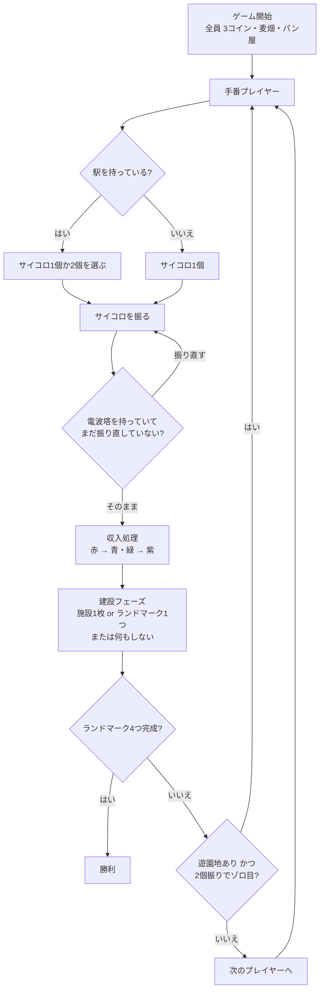
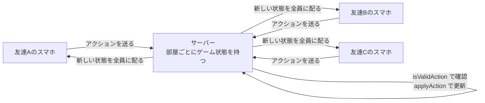

# サイコロタウン 設計書（v0.1）

> サイコロを振って収入を得て、施設を建てて街を育てるボードゲームを、ブラウザで遊べる1人用ゲーム（あなた vs CPU）として実装する。
> ルールの仕組みは市販ボードゲーム「街コロ」の基本セットを参考にするが、**タイトル・ロゴ・カードの絵柄は使わず、すべてオリジナル**にする。アイコンは絵文字かシンプルな図形で描く。

---

## 1. ゴール

| 項目 | 内容 |
|---|---|
| 遊び方 | ブラウザでページを開くだけで遊べる |
| 人数 | 2〜4人。各席を「人間」か「CPU」から選べる（例: 人間1+CPU3、人間4人）。人間が複数いるときは同じ端末を回して遊ぶ |
| 1ゲーム | 15〜30分 |
| 勝利条件 | 4つのランドマークを最初に全部建てた人が勝ち |
| 途中保存 | **必須**。ブラウザに自動保存し、閉じても続きから遊べる（10章） |
| 公開 | GitHub Pages（2章） |
| 対象外（v1ではやらない） | オンライン対戦（v2で対応。13章）、拡張カード、ハウスルールの設定（初期コインや勝利条件の変更）、CPUの難易度選択、サウンド |

---

## 2. 技術構成

| 項目 | 採用 |
|---|---|
| 言語 | TypeScript |
| ビルド | Vite |
| UI | React（関数コンポーネント + hooks） |
| スタイル | CSS Modules もしくは素のCSS |
| アニメーション | Motion（旧 Framer Motion）＋ CSS transition |
| テスト | Vitest（ゲームロジックの単体テスト） |
| サーバー | なし（全部ブラウザ内で完結） |
| 公開 | GitHub Pages。`main` ブランチに push したら GitHub Actions で自動ビルド・公開する |

### GitHub Pages 用の設定
- `vite.config.ts` の `base` をリポジトリ名に合わせる（例: `base: '/saikoro-town/'`）
- `.github/workflows/deploy.yml` で「`npm ci` → `npm test` → `npm run build` → Pages に公開」を行う。テストが落ちたら公開しない
- 画像は `public/` に置き、パスは `import.meta.env.BASE_URL` を頭につけて参照する（公開後に画像が表示されない事故を防ぐ）

### ディレクトリ構成

```
src/
  game/              ← UIに依存しない純粋なゲームロジック
    cards.ts         カード定義（マスターデータ）
    types.ts         型定義
    state.ts         初期状態の生成
    engine.ts        サイコロ・収入処理・購入・勝利判定
    ai.ts            CPUの思考
    engine.test.ts   ロジックのテスト
  ui/
    App.tsx
    components/      Board, PlayerArea, Market, DiceArea, Log, Modal など
  main.tsx
```

**大事な方針**：ゲームのルールは `src/game/` に閉じ込めて、UIからは「状態を渡して、新しい状態を受け取る」だけにする（純粋関数）。こうするとテストしやすく、CPUの思考にも同じ関数を使い回せる。

---

## 3. ゲームの全体の流れ



---

## 4. カードの種類（色のルール）

| 色 | いつ収入が入るか | お金の出どころ |
|---|---|---|
| 🔵 青 | **誰の手番でも**、その目が出たら | 銀行 |
| 🟢 緑 | **自分の手番だけ**、その目が出たら | 銀行 |
| 🔴 赤 | **他の人の手番で**、その目が出たら | サイコロを振った人から奪う |
| 🟣 紫 | **自分の手番だけ**、その目が出たら | 他のプレイヤーから奪う |

- 紫カードは**1人につき各種類1枚まで**しか持てない。
- 同じカードを複数枚持っていたら、その枚数ぶん効果が出る。

---

## 5. カード一覧（マスターデータ）

### 5-1. 施設カード

| ID | 名前 | 色 | 目 | コスト | アイコン分類 | 効果 | 在庫 |
|---|---|---|---|---|---|---|---|
| wheat | 麦畑 | 青 | 1 | 1 | 🌾 農業 | 銀行から1コイン | 6 |
| ranch | 牧場 | 青 | 2 | 1 | 🐄 畜産 | 銀行から1コイン | 6 |
| bakery | パン屋 | 緑 | 2–3 | 1 | 🏪 商店 | 銀行から1コイン | 6 |
| cafe | カフェ | 赤 | 3 | 2 | ☕ 飲食 | 振った人から1コイン | 6 |
| convenience | コンビニ | 緑 | 4 | 2 | 🏪 商店 | 銀行から3コイン | 6 |
| forest | 森 | 青 | 5 | 3 | ⚙️ 資源 | 銀行から1コイン | 6 |
| stadium | スタジアム | 紫 | 6 | 6 | 🏛 大型 | 他の全員から2コインずつ | 人数分 |
| tv | テレビ局 | 紫 | 6 | 7 | 🏛 大型 | 好きな1人から5コイン | 人数分 |
| business | ビジネスセンター | 紫 | 6 | 8 | 🏛 大型 | 好きな1人と施設を1枚交換（紫は交換不可） | 人数分 |
| cheese | チーズ工場 | 緑 | 7 | 5 | 🏭 工場 | 自分の🐄の枚数 × 3コイン | 6 |
| furniture | 家具工場 | 緑 | 8 | 3 | 🏭 工場 | 自分の⚙️の枚数 × 3コイン | 6 |
| mine | 鉱山 | 青 | 9 | 6 | ⚙️ 資源 | 銀行から5コイン | 6 |
| restaurant | ファミレス | 赤 | 9–10 | 3 | ☕ 飲食 | 振った人から2コイン | 6 |
| apple | りんご園 | 青 | 10 | 3 | 🌾 農業 | 銀行から3コイン | 6 |
| market | 青果市場 | 緑 | 11–12 | 2 | 🍎 市場 | 自分の🌾の枚数 × 2コイン | 6 |

### 5-2. ランドマーク

| ID | 名前 | コスト | 効果 |
|---|---|---|---|
| station | 駅 | 4 | サイコロを1個か2個、選んで振れる |
| mall | ショッピングモール | 10 | 自分の🏪と☕のカードの収入が1枚につき+1 |
| park | 遊園地 | 16 | 2個振りでゾロ目が出たら、もう1回手番 |
| tower | 電波塔 | 22 | 1手番に1回、サイコロを振り直せる |

- 紫カードの在庫は**プレイ人数と同じ枚数**（2人戦なら各2枚、4人戦なら各4枚）。
- 電波塔で振り直したときは、**最後に出た目だけ**を使う。遊園地のゾロ目判定も最後の目で行う（1回目がゾロ目でも、振り直してゾロ目でなければ追加手番なし）。

### 5-3. 初期状態

- 各プレイヤー：3コイン、麦畑1枚、パン屋1枚、ランドマークはすべて未建設
- 初期カードは在庫（市場）から減らさない
- 手番順はランダムで決める

---

## 6. 収入処理（いちばん大事なところ）

サイコロの合計値を `roll`、振った人を `active` とする。**必ずこの順番で処理する。**

### ① 赤カード
- `active` 以外のプレイヤーが対象。**`active` から見て手番の逆順**（直前の手番の人から）に処理する。
- 各プレイヤーについて、`roll` に合う赤カードの枚数 × 金額（モールがあれば+1/枚）を `active` から奪う。
- `active` の所持金が足りなければ、**ある分だけ**渡す。0になったら残りの人は何ももらえない。

### ② 青・緑カード
- 🔵 青：全プレイヤーが対象。合う枚数 × 金額を銀行から受け取る。
- 🟢 緑：`active` だけが対象。
  - パン屋・コンビニはモールがあれば+1/枚。
  - チーズ工場・家具工場・青果市場は「対象アイコンの枚数 × 金額」を、工場1枚ごとに計算。
- 銀行のお金は無限とする。

### ③ 紫カード（`active` のみ）
- スタジアム：他の全員から2コインずつ（足りない人からはある分だけ）。
- テレビ局：1人を選んで5コイン（足りなければある分だけ）。
- ビジネスセンター：相手1人を選び、自分の施設1枚と相手の施設1枚を交換（紫カードは対象外）。交換したくなければスキップしてよい。

### 例
4人戦、Aが3を出した。Bがカフェ1枚、Dがカフェ2枚、Aは2コイン、手番順は A→B→C→D。
- 逆順なので D から：Dは2コイン欲しい → Aから2コイン、Aは0に
- 次に B：Aは0なので何ももらえない
- その後、Aのパン屋（2–3）が発動し、Aは銀行から1コイン

---

## 7. 建設フェーズ

- 1手番に**1つだけ**買える：施設1枚 か ランドマーク1つ。または何も買わない。
- 条件：所持金 ≥ コスト、在庫がある、紫は未所持、ランドマークは未建設。
- ランドマークは好きな順番で建ててよい。
- ランドマークが4つそろった瞬間に勝利（その後の処理はしない）。

---

## 8. データモデル（型の案）

```ts
type Color = 'blue' | 'green' | 'red' | 'purple';
type Icon = 'wheat' | 'cow' | 'gear' | 'shop' | 'cup' | 'factory' | 'fruit' | 'major';

interface CardDef {
  id: string;
  name: string;
  color: Color;
  rolls: number[];        // 例: [2, 3]
  cost: number;
  icon: Icon;
  emoji: string;          // 画像がないときの代わりの表示
  image?: string;         // カード絵のファイル名（例: 'wheat.png'）。なければ emoji を表示
  description: string;
}

type LandmarkId = 'station' | 'mall' | 'park' | 'tower';

interface Player {
  id: number;
  name: string;
  isHuman: boolean;
  coins: number;
  cards: Record<string, number>;           // カードID → 枚数
  landmarks: Record<LandmarkId, boolean>;
}

type Phase =
  | 'chooseDice'        // 1個/2個を選ぶ
  | 'rolled'            // 振り直すか決める
  | 'resolving'         // 収入処理中（テレビ局などの選択待ちを含む）
  | 'build'             // 建設
  | 'gameOver';

interface GameState {
  players: Player[];
  supply: Record<string, number>;          // 在庫
  current: number;                         // 手番プレイヤーのindex
  phase: Phase;
  dice: number[];                          // 直近の出目
  rerollUsed: boolean;
  pendingChoice?: PendingChoice;           // テレビ局・ビジネスセンターの選択待ち
  log: LogEntry[];
  winner?: number;
}
```

### エンジンの関数（すべて純粋関数）

| 関数 | 役割 |
|---|---|
| `createGame(numPlayers, seed?)` | 初期状態をつくる |
| `rollDice(state, count, rng)` | サイコロを振る |
| `reroll(state, rng)` | 電波塔で振り直す |
| `resolveIncome(state)` | 赤→青緑→紫の収入処理。選択が必要なら `pendingChoice` を立てて止まる |
| `applyChoice(state, choice)` | テレビ局・ビジネスセンターの選択を反映 |
| `getBuildOptions(state)` | 今買えるもの一覧 |
| `build(state, cardIdOrLandmarkId \| null)` | 購入して手番終了処理（勝利判定・遊園地・次の人へ） |

- 乱数は引数で渡す（`rng: () => number`）。テストではシード付き乱数で結果を固定する。

### アクション方式（オンライン対応の準備）
プレイヤーの操作はすべて「アクション」というデータで表し、1つの入口関数で処理する。

```ts
type Action =
  | { type: 'CHOOSE_DICE'; playerId: number; count: 1 | 2 }
  | { type: 'REROLL'; playerId: number }
  | { type: 'KEEP'; playerId: number }
  | { type: 'CHOOSE_TARGET'; playerId: number; targetId: number }          // テレビ局
  | { type: 'SWAP'; playerId: number; targetId: number; give: string; take: string } // ビジネスセンター
  | { type: 'SKIP_SWAP'; playerId: number }
  | { type: 'BUILD'; playerId: number; id: string | null };               // null = 何も買わない

function applyAction(state: GameState, action: Action, rng: () => number): { state: GameState; events: GameEvent[] };
function isValidAction(state: GameState, action: Action): boolean;
```

### イベント（アニメーションのための記録）
`applyAction` は新しい状態と一緒に「何が起きたか」の一覧（イベント）を返す。UIはこれを順番に再生してアニメーションにする。ゲームロジックはアニメーションのことを一切知らなくていい。

```ts
type GameEvent =
  | { type: 'DICE_ROLLED'; playerId: number; dice: number[] }
  | { type: 'CARD_TRIGGERED'; playerId: number; cardId: string }                  // カードが光る
  | { type: 'COINS_MOVED'; from: number | 'bank'; to: number; amount: number; cardId?: string } // コインが飛ぶ
  | { type: 'CARDS_SWAPPED'; a: number; b: number; aCard: string; bCard: string }
  | { type: 'BUILT'; playerId: number; id: string }                              // 建設
  | { type: 'LANDMARK_COMPLETED'; playerId: number; id: LandmarkId }
  | { type: 'EXTRA_TURN'; playerId: number }                                     // 遊園地
  | { type: 'TURN_STARTED'; playerId: number }
  | { type: 'GAME_WON'; playerId: number };
```

- 状態はすぐに確定させ、画面の数字だけアニメーションに合わせて遅れて変える（アニメーション中に閉じても、保存データは正しい）。
- イベントの合計と状態の変化は必ず一致させる（例: `COINS_MOVED` の合計 = 所持金の増減）。

- 人間のクリックも、CPUの判断も、（将来の）オンラインの相手の操作も、**全部同じ `applyAction` を通る**。
- `isValidAction` で「その人の手番か」「今のフェーズでできる操作か」を必ずチェックする。
- `GameState` は JSON にそのまま変換できる形にする（関数やクラスを入れない）。これでネット越しに送ったり保存したりできる。

### 同じ端末で複数人が遊ぶとき
- 人間の手番が来たら「〇〇さんの番です」と大きく表示して、タップしてから操作できるようにする。
- 誰の番か分かるように、手番プレイヤーの色で画面の枠を光らせる。

---

## 9. CPUの思考

CPUの強さは「ふつう」1種類だけ（難易度選択はなし）。そのかわり、CPUごとに「性格」をランダムに割り当てて、毎回ちがう展開になるようにする。

| 性格 | 方針 |
|---|---|
| コツコツ型 | 1個振り。パン屋・コンビニ・カフェを集め、モールを早めに建てる |
| 牧場工場型 | 駅を早めに建て、牧場を集めてチーズ工場（7） |
| 資源工場型 | 駅を早めに建て、森・鉱山を集めて家具工場（8） |
| バランス型 | 期待値が一番高いものを買う |

### 判断のルール

1. **サイコロの数**：駅あり かつ 7以上の目のカードを持っていれば2個、それ以外は1個。
2. **振り直し**（電波塔）：今の出目で自分の収入が0、または次のランドマーク購入に届かないときは振り直す。
3. **建設の優先順位**
   - ランドマークを買えるなら買う（ただし性格に応じて、序盤は施設を優先してもよい）
   - 買えなければ、性格ごとの「欲しいカード」に点数をつけて最高点を買う
   - 点数 = その目の出る確率 × そのカードの収入 + 性格ボーナス
   - 買う価値があるものがなければ何も買わない（無理に麦畑を買い続けない）
4. **テレビ局**：一番お金を持っている人を選ぶ。
5. **ビジネスセンター**：自分の一番安い施設と、相手の一番価値が高い施設を交換。

### サイコロの確率（2個振り）

```
目:   2  3  4  5  6  7  8  9  10 11 12
回数: 1  2  3  4  5  6  5  4  3  2  1   （36通り中）
```

### 演出
- CPUの手番は自動で進むが、**1アクションごとに 0.6〜1秒の間を置く**（何が起きたか目で追えるように）。
- 「早送り」ボタンで間を0にできる。

---

## 10. 画面設計

### デザインの方向性：A案「クラシック卓上」に決定
木の枠の中に緑のフェルトを敷いた、テーブルで遊んでいるような見た目にする。

| 用途 | 色 |
|---|---|
| 外枠（木） | `#6B4626` |
| フェルト（背景） | `#1F5240` |
| フェルトの濃い部分（サイコロ・市場・ログの台） | `#183F31` |
| パネル（プレイヤー欄・自分の欄） | `#F6EFDF` |
| カードの地 | `#FFFDF7` |
| 文字 | `#2B2118`（明るい地の上）／`#F6EFDF`（フェルトの上） |
| コイン・完成したランドマーク | `#E3B23C`（縁 `#9A6F12`） |
| カードの色：青 / 緑 / 赤 / 紫 | `#2563C9` / `#1F7A45` / `#C23B3B` / `#6E44B8` |

- フォント：Zen Maru Gothic（Google Fonts）。見出しは太字900、本文は500〜700
- 角丸：パネル12px、カード10px、ボタン10px
- 未完成のランドマークは点線の枠、完成したら金色で塗る
- お金が足りないカードは不透明度45%で薄く表示する
- 市場の上に色の凡例（青 いつでも／緑 自分の番／赤 相手の番／紫 大型）を常に出しておく

```
┌────────────────────────────────────────────────────────┐
│  サイコロタウン          ターン12  手番: あなた   [ルール] │
├──────────────┬─────────────────────────┬───────────────┤
│ CPU 1        │                         │  ログ          │
│ 💰8  🏗2/4   │     🎲 [ 4 ] [ 3 ]       │  ・CPU2が7を出し│
│ カード一覧    │       合計 7            │    た          │
├──────────────┤                         │  ・あなたのチーズ│
│ CPU 2        │  [1個振る] [2個振る]     │    工場 +9     │
│ 💰3  🏗1/4   │  [振り直す] [そのまま]    │  ・...         │
├──────────────┤                         │               │
│ CPU 3        │                         │               │
│ 💰12 🏗3/4   │                         │               │
├──────────────┴─────────────────────────┴───────────────┤
│  市場（買えるものは明るく、買えないものは暗く）           │
│  [🌾麦畑 1] [🐄牧場 1] [🍞パン屋 1] [☕カフェ 2] ...     │
│  ランドマーク: [🚉駅 4] [🛍モール 10] [🎡遊園地 16] [📡電波塔 22] │
│                                      [何も買わない]    │
├────────────────────────────────────────────────────────┤
│  あなた  💰 15   ランドマーク 🚉✅ 🛍⬜ 🎡⬜ 📡⬜         │
│  [🌾×2] [🍞×1] [🐄×3] [🧀×1] ...                       │
└────────────────────────────────────────────────────────┘
```

### UIのポイント
- カードは**色で4種類が一目でわかる**ようにする（青・緑・赤・紫の枠）。
- カードに「目」「コスト」「効果の短い説明」を表示。ホバー（スマホはタップ）で詳しい説明。
- 収入が入ったら、そのプレイヤーの所持金の横に `+3` のようなポップアップを出す。
- 出目に反応したカードを一瞬光らせる。
- テレビ局は「相手を選ぶ」モーダルを1回出す（各プレイヤーの所持金も表示）。
- ビジネスセンターは3ステップのモーダルにする：
  1. **相手を選ぶ**（紫以外の施設を持っている人だけ選べる）
  2. **渡すカードを選ぶ**（自分の紫以外の施設）
  3. **もらうカードを選ぶ**（相手の紫以外の施設）→ 確認して交換
  - 各ステップに「戻る」ボタン、1ステップ目に「交換しない」ボタンを置く。
- スマホ（幅375px〜）でも遊べるように、縦並びのレイアウトにも対応する。
- 開始画面：人数（2〜4）を選んで「スタート」。
- 終了画面：勝者と、各プレイヤーの最終状態を表示。「もう一回」ボタン。

### スマホ版：A案のタブ切り替えに決定
幅768px未満ではスマホ用のレイアウトに切り替える。

```
┌──────────────────────────┐
│ サイコロタウン   ターン12・建設 │ ← 木の色のヘッダー
├──────────────────────────┤
│ [ハル 8c ■■□□][ミナト][ソラ] │ ← 相手3人（タップで詳細）
│ ┌──────────────────────┐ │
│ │ 🎲🎲  7  チーズ工場 +9  │ │ ← サイコロと結果
│ └──────────────────────┘ │
│ [💰6][駅✅][モール][遊園地][電波塔]│ ← 自分の所持金とランドマーク
├──────────────────────────┤
│                          │
│   タブの中身（スクロール）     │ ← 市場なら3列のカード
│                          │
├──────────────────────────┤
│ [市場][自分の街][相手][ログ]  │ ← 下のタブ（高さ56px）
└──────────────────────────┘
```

- 上半分（相手・サイコロ・自分の所持金とランドマーク）は常に表示し、タブで切り替わるのは下の部分だけ。
- 建設フェーズになったら自動で「市場」タブを開く。それ以外のフェーズでは最後に開いていたタブのまま。
- 「相手」タブ：3人の持っているカードを一覧で表示。
- 「ログ」タブ：新しいものを上に表示。
- ボタンやタップできる部分は高さ44px以上にする。

### アニメーション
イベント（8章）を順番に再生して演出する。

| イベント | 演出 | 長さの目安 |
|---|---|---|
| サイコロを振る | サイコロが転がって止まる（ランダムな目を数回切り替えてから最終の目） | 0.8秒 |
| カードが発動 | 該当カードが光って少し跳ねる | 0.3秒 |
| コインの移動 | コインが渡す側から受け取る側へ飛ぶ。所持金の数字がカウントアップし、`+3` が浮かぶ | 0.5秒 |
| 施設を建てる | 市場のカードが自分のエリアへ移動して置かれる | 0.5秒 |
| ランドマーク完成 | 点線の枠が金色に塗られ、キラッと光る | 0.8秒 |
| 手番交代 | 「〇〇の番」の帯が画面を横切る | 0.6秒 |
| 遊園地で追加手番 | 「もう1回！」の表示 | 0.6秒 |
| 勝利 | 紙吹雪と勝者の表示 | 2秒 |

- 同じタイミングのコイン移動（青カードで全員に収入など）はまとめて同時に再生する。
- 設定でアニメーションの速さを「ふつう／はやい／なし」から選べるようにする。CPUの手番の早送りボタンは「はやい」と同じ扱い。
- 端末の「視差効果を減らす」設定（`prefers-reduced-motion`）がオンなら、動きを最小限にする。
- アニメーション中は人間の操作を受け付けない。画面をタップするとそのアニメーションを飛ばせる。

### 途中保存（必須）
- ゲームの状態（`GameState`）を、**アクションを1つ処理するたびに** `localStorage` に自動保存する。
- 保存するのは1ゲーム分だけ。キー名は `saikoro-town:save`。データにバージョン番号（`version: 1`）をつけ、読み込めない古いデータは捨てる。
- ページを開いたとき保存があれば、開始画面に「続きから」と「新しく始める」を出す。「新しく始める」は確認してから保存を消す。
- CPUの手番の途中で閉じても、再開したらその手番の続きから進む。
- ゲームが終わったら保存を消す。
- `localStorage` が使えない環境（プライベートモードなど）でもエラーで止まらず、保存なしで遊べるようにする。

### カード絵の差し替え
あとからカードの絵を自由に変えられるように、絵とプログラムを分けておく。

- カード絵は `public/cards/` に **カードIDと同じ名前** で置く（例: `public/cards/wheat.png`、`public/cards/station.png`）
- 画像ファイルがあれば画像を表示し、なければ絵文字を表示する（画像の読み込みに失敗したときも絵文字に戻す）
- 画像の推奨サイズは 正方形 512×512px、形式は PNG / WebP / SVG のどれでもよい
- カードの枠（色・目・コスト・名前）はプログラム側で描き、画像は**中央の絵の部分だけ**に使う。だから絵を変えても、色分けや数字の見やすさは変わらない
- 背景・ロゴ・サイコロの見た目も `public/theme/` にまとめて、同じように差し替えられるようにする

```
public/
  cards/      wheat.png, ranch.png, bakery.png, ... station.png, mall.png ...
  theme/      background.png, logo.png, dice-1.svg 〜 dice-6.svg
```

---

## 11. テスト項目（受け入れ基準）

ロジックはVitestで、以下を必ずテストする。

- [ ] 初期状態：全員3コイン・麦畑1・パン屋1
- [ ] 青：他人の手番でも収入が入る
- [ ] 緑：自分の手番でしか収入が入らない
- [ ] 赤：振った人から奪う。逆順で処理される。お金が足りないときはある分だけ
- [ ] 赤 → 青緑 → 紫 の順番が守られる（赤で0になった後に緑で収入が入るケース）
- [ ] チーズ工場：牧場3枚・工場1枚で9コイン、工場2枚で18コイン
- [ ] 家具工場：森と鉱山の両方を数える
- [ ] 青果市場：麦畑とりんご園の両方を数える
- [ ] モール：パン屋・コンビニ・カフェ・ファミレスが+1、他は変わらない
- [ ] スタジアム・テレビ局：足りない相手からはある分だけ
- [ ] ビジネスセンター：紫カードは交換できない
- [ ] 紫カードは1人1枚まで。在庫はプレイ人数と同じ枚数
- [ ] 電波塔で振り直したら、遊園地のゾロ目判定は最後の目で行う
- [ ] 保存した状態を読み込むと、保存前とまったく同じ状態に戻る
- [ ] `COINS_MOVED` イベントの合計と、各プレイヤーの所持金の増減が一致する
- [ ] 赤 → 青緑 → 紫 の順でイベントが並んでいる
- [ ] 壊れた保存データやバージョンが違うデータは無視して、新しいゲームを始められる
- [ ] 在庫0のカードは買えない
- [ ] 駅がないと2個振りできない
- [ ] 電波塔の振り直しは1手番1回
- [ ] 遊園地：2個振りゾロ目で追加手番、1個振りでは発動しない
- [ ] ランドマーク4つで即勝利
- [ ] CPU同士だけで100ゲーム回して、全ゲームが正常に終わる（無限ループしない）

---

## 12. 実装ステップ

1. **ロジックだけ**：`cards.ts` → `types.ts` → `engine.ts` → テスト。ここで全テストを通す
2. **最低限のUI**：テキストだけでいいので、1人で最後まで遊べる状態にする
3. **CPU**：`ai.ts` を作り、CPU 3人と対戦できるようにする
4. **見た目**：カードのデザイン、アニメーション、ログ、スマホ対応
5. **仕上げ**：ルール説明画面、早送り、もう一回ボタン

---

## 13. 将来：オンライン対戦（v2）

v1 では作らないが、v1 の作りをそのまま使えるように方針だけ決めておく。

### 遊び方のイメージ
1. ホストが「部屋を作る」→ 4桁の部屋コードが出る
2. 友達はそれぞれ自分のスマホでページを開き、部屋コードを入れて参加
3. 空いている席は CPU で埋められる
4. 全員そろったらホストが「スタート」

### しくみ



- **ルール判定とサイコロはサーバーがやる**（スマホ側でサイコロを振るとズルができてしまうため）。
- サーバーは `src/game/` のコードをそのまま使う。だから v1 でロジックを UI から切り離しておくことが大事。
- 候補の技術：Supabase Realtime / Firebase / PartyKit（Cloudflare）など。v2 の時点で選ぶ。
- 途中で通信が切れた人は、同じ部屋コードで入り直せば続きから遊べるようにする。

### v1 で守っておくこと（チェックリスト）
- [ ] ゲームロジックが React や画面に一切依存していない
- [ ] すべての操作が `Action` → `applyAction` を通っている
- [ ] `GameState` が JSON に変換できる
- [ ] 乱数が外から渡せる

---

## 付録：Claude Code に渡すときのプロンプト例

```
この SPEC.md を読んで、サイコロタウンを実装してください。
- 12章の実装ステップの順番で進めてください
- まずステップ1（ロジック + テスト）だけ作って、テストが全部通ったら一度止まって報告してください
- 仕様で曖昧なところがあれば、勝手に決めずに質問してください
```
